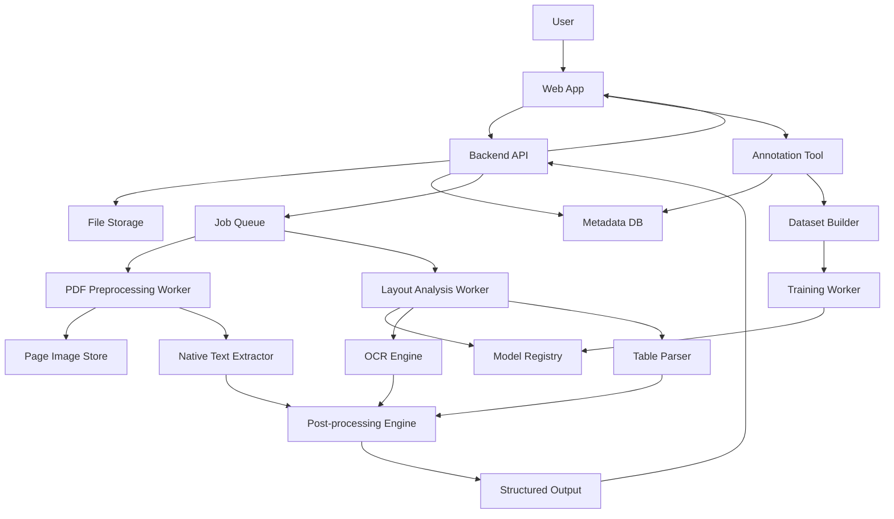
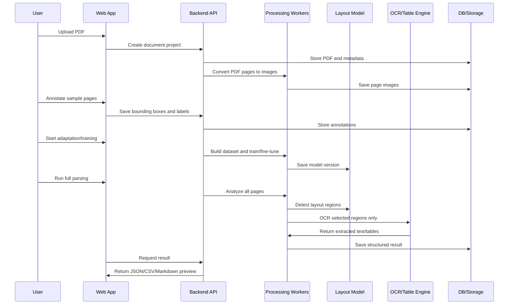

# Intelligent PDF Parsing Platform Specification

## 1. Software Architecture

### 1.1 System Purpose

This platform analyzes PDFs with highly variable layouts, lets users annotate document regions, adapts a layout detection model to each document family, and extracts structured data only from relevant regions.

The core value is not generic OCR. The core value is user-defined layout understanding:

- Detect meaningful regions such as title, body, table, figure, header, footer, note, and target data.
- Exclude unnecessary regions before OCR or LLM processing.
- Fine-tune or adapt layout analysis behavior from a small number of annotated pages.
- Produce structured outputs such as JSON, CSV, Markdown, and API responses.

### 1.2 High-Level Component Diagram

### 1.3 Runtime Pipeline

### 1.4 Main Software Modules

| Module | Responsibility | Candidate Stack |
| --- | --- | --- |
| Web App | PDF upload, project management, annotation UI, result review | Next.js, React, PDF.js |
| Annotation Tool | Draw/edit bounding boxes, assign labels, page navigation, shortcuts | React canvas/SVG overlay |
| Backend API | Auth, projects, files, annotations, jobs, outputs | FastAPI |
| PDF Preprocessor | PDF-to-image conversion, page metadata extraction, native text extraction | PyMuPDF, pdf2image |
| Dataset Builder | Convert annotations to YOLO/COCO format, split train/val data | Python |
| Layout Model Service | Baseline inference and custom fine-tuned inference | DocLayout-YOLO or YOLO-based model |
| Training Worker | Fine-tuning, evaluation, artifact creation | PyTorch, Ultralytics, MLflow |
| OCR Engine | OCR selected text regions | PaddleOCR, EasyOCR, Tesseract |
| Table Parser | Extract table structure and cells | Table Transformer, Camelot, Tabula, VLM fallback |
| Post-processing | Reading order, text cleanup, schema mapping, confidence scoring | Python |
| Storage | PDFs, page images, crops, outputs, model artifacts | S3-compatible storage |
| Database | Users, projects, documents, annotations, jobs, model versions | PostgreSQL |
| Queue | Async processing and training jobs | Redis, Celery/RQ |

### 1.5 Data Flow

1. PDF file is uploaded and stored.
2. Each page is rendered as an image.
3. Existing PDF text is extracted when available.
4. User annotates a small set of pages.
5. Annotation data is converted into a training dataset.
6. A layout detection model is trained or adapted.
7. The model detects regions across the full document.
8. Region policies decide whether to OCR, skip, parse as table, or preserve as image.
9. Text/table extraction results are merged into structured output.
10. User reviews and corrects the result.
11. Corrections are stored as additional training feedback.

### 1.6 Suggested MVP Scope

MVP should prove one thing clearly:

Given 10 to 20 annotated pages from a document family, the system can classify useful and useless regions well enough to reduce OCR noise and extract target information more reliably than full-page OCR.

MVP includes:

- PDF upload.
- Page image conversion.
- Manual annotation UI.
- Label classes: title, body, table, figure, header, footer, ignore, target_data.
- Baseline model inference.
- Fine-tuning experiment.
- OCR only on selected classes.
- JSON and Markdown output.
- Result review screen.

MVP excludes:

- Multi-tenant enterprise admin.
- Complex role-based permissions.
- Full VLM reasoning pipeline.
- Fully automated schema induction.
- Large-scale active learning automation.

## 2. Requirements Specification

### 2.1 User Roles

| Role | Description |
| --- | --- |
| Admin | Manages users, projects, model versions, and system settings. |
| Document Operator | Uploads PDFs, annotates sample pages, runs parsing jobs, reviews results. |
| Reviewer | Checks extracted results and corrects errors. |
| Developer/API User | Integrates parsing results through API. |

### 2.2 Functional Requirements

| ID | Requirement | Priority | Acceptance Criteria |
| --- | --- | --- | --- |
| FR-001 | Users can upload PDF documents. | Must | PDF is stored, document metadata is created, pages are queued for preprocessing. |
| FR-002 | System converts PDF pages into images. | Must | Each page has a rendered image with page number, width, height, and resolution metadata. |
| FR-003 | System extracts native text from text-based PDFs when available. | Should | Native text blocks are stored with coordinates and confidence/source metadata. |
| FR-004 | Users can annotate page regions with bounding boxes. | Must | User can create, resize, move, delete, and relabel boxes. |
| FR-005 | Users can define or select layout labels. | Must | Default labels exist and project-specific labels can be configured. |
| FR-006 | Annotation data is versioned. | Should | Changes are tracked by document, page, label, user, and timestamp. |
| FR-007 | System can export annotations to model training format. | Must | YOLO-format dataset can be generated from selected annotated pages. |
| FR-008 | System can run baseline layout detection. | Must | For a page image, the system returns region boxes, labels, confidence, and model version. |
| FR-009 | System can fine-tune or adapt the layout model using user annotations. | Must | A model version is created and can be selected for inference. |
| FR-010 | System evaluates model performance on a validation set. | Should | Precision, recall, mAP, and per-class metrics are visible. |
| FR-011 | Users can run parsing on the full document. | Must | All pages are processed and output is generated asynchronously. |
| FR-012 | Region policies determine extraction behavior by label. | Must | Example: ignore/footer/figure skipped, table sent to table parser, body/title sent to OCR. |
| FR-013 | System performs OCR on selected regions only. | Must | OCR crops are generated from selected detected boxes, not the entire page by default. |
| FR-014 | System can parse table regions. | Should | Table regions return row/column/cell structure when parser confidence is acceptable. |
| FR-015 | System generates structured output. | Must | JSON output contains pages, regions, labels, text, tables, confidence, and coordinates. |
| FR-016 | System can export results. | Must | User can download JSON and Markdown; CSV export is available for table/target data. |
| FR-017 | Users can review and correct parsed results. | Should | Edits are saved and linked back to source regions. |
| FR-018 | User corrections can be reused as feedback data. | Should | Corrected labels and outputs can be added to future training sets. |
| FR-019 | API users can submit PDFs and retrieve results programmatically. | Could | API supports upload, job status, and result retrieval. |
| FR-020 | System tracks job status. | Must | Jobs show pending, running, succeeded, failed, and error message states. |

### 2.3 Non-Functional Requirements

| ID | Requirement | Target |
| --- | --- | --- |
| NFR-001 | Accuracy | MVP target: region classification F1 above 0.85 on same document family after 20 annotated pages. |
| NFR-002 | Latency | Page preprocessing should complete within a practical async batch flow; UI must not block during jobs. |
| NFR-003 | Scalability | Architecture should support worker scaling for OCR and layout inference. |
| NFR-004 | Traceability | Every output item must reference source document, page, region box, model version, and OCR engine. |
| NFR-005 | Reproducibility | Training jobs must store dataset version, parameters, metrics, and model artifacts. |
| NFR-006 | Security | Uploaded PDFs and extracted data must be access-controlled by project/user. |
| NFR-007 | Privacy | Documents must not be sent to external APIs unless explicitly configured. |
| NFR-008 | Reliability | Failed jobs should expose failure reason and allow retry. |
| NFR-009 | Maintainability | Model pipeline, OCR pipeline, and UI should be modular and replaceable. |
| NFR-010 | Cost Control | System should skip OCR/LLM processing for ignored regions to reduce compute and token usage. |

### 2.4 Data Requirements

#### Document

- document_id
- project_id
- filename
- file_hash
- page_count
- upload_status
- created_by
- created_at

#### Page

- page_id
- document_id
- page_number
- image_uri
- width
- height
- dpi
- native_text_available

#### Annotation

- annotation_id
- page_id
- label
- bbox: x, y, width, height
- created_by
- source: manual, prediction, correction
- version
- created_at

#### Model Version

- model_version_id
- project_id
- base_model
- dataset_version
- training_config
- metrics
- artifact_uri
- status
- created_at

#### Parsed Region

- region_id
- page_id
- model_version_id
- label
- bbox
- confidence
- extraction_policy
- text
- table_data
- ocr_engine
- created_at

### 2.5 Region Policy Requirements

| Label | Default Policy |
| --- | --- |
| title | OCR or native text extraction, preserve heading hierarchy. |
| body | OCR or native text extraction, merge by reading order. |
| table | Table parser first, OCR fallback. |
| figure | Skip OCR by default, optionally generate caption/alt text. |
| header | Skip or extract depending on project setting. |
| footer | Skip by default. |
| ignore | Always skip. |
| target_data | High-priority OCR and schema extraction. |

### 2.6 External Interface Requirements

#### Upload API

- `POST /documents`
- Input: PDF file, project_id
- Output: document_id, preprocessing_job_id

#### Annotation API

- `POST /pages/{page_id}/annotations`
- `GET /pages/{page_id}/annotations`
- `PUT /annotations/{annotation_id}`
- `DELETE /annotations/{annotation_id}`

#### Training API

- `POST /projects/{project_id}/training-jobs`
- `GET /training-jobs/{job_id}`
- `GET /projects/{project_id}/model-versions`

#### Parsing API

- `POST /documents/{document_id}/parse-jobs`
- `GET /parse-jobs/{job_id}`
- `GET /documents/{document_id}/results`

## 3. Core User Scenarios

### Scenario 1: First-Time Document Family Setup

**Actor:** Document Operator  
**Goal:** Teach the system a new document layout.

1. User creates a new project named after a document family.
2. User uploads a representative PDF manual or report.
3. System converts pages into images.
4. User opens the annotation screen.
5. User annotates 10 to 20 representative pages.
6. User labels regions such as title, body, table, figure, footer, ignore, and target_data.
7. User starts a training job.
8. System builds a dataset, trains or fine-tunes a layout model, and creates a model version.
9. User checks validation metrics and sample predictions.
10. User approves the model version for parsing.

**Success Criteria:**

- A reusable model version exists for the project.
- The model correctly separates useful text/table regions from ignored visual or footer regions in sample pages.

**Failure/Exception Flow:**

- If performance is low, the system recommends adding more annotations for confused classes.
- If table/header confusion is high, user adds more examples of both classes.

### Scenario 2: Parse a Full PDF with Selected OCR

**Actor:** Document Operator  
**Goal:** Extract only useful content from a large PDF.

1. User uploads a new PDF with the same or similar layout.
2. User selects the approved project model.
3. User starts full parsing.
4. System detects layout regions on every page.
5. System skips ignore/footer/figure regions.
6. System sends body/title/target_data regions to OCR or native text extraction.
7. System sends table regions to the table parser.
8. System merges extracted content by page and reading order.
9. User reviews JSON, Markdown, and table previews.
10. User exports the result.

**Success Criteria:**

- OCR noise is reduced because irrelevant regions are skipped.
- Output preserves page, region, label, and coordinate traceability.

**Failure/Exception Flow:**

- If OCR quality is poor, user can rerun selected regions with a different OCR engine.
- If layout detection misses a region, user corrects it and saves feedback.

### Scenario 3: Correct Results and Improve the Model

**Actor:** Reviewer  
**Goal:** Fix parsing mistakes and improve future performance.

1. Reviewer opens parsed result.
2. Reviewer sees page image and extracted regions side by side.
3. Reviewer identifies a misclassified region.
4. Reviewer changes the label, adjusts the bounding box, or marks it as ignore.
5. Reviewer corrects extracted text or table cells.
6. System saves corrections as feedback data.
7. User starts a retraining job when enough corrections accumulate.
8. New model version is evaluated against the previous model.

**Success Criteria:**

- Corrections are stored as structured feedback.
- New model version improves target classes without degrading critical classes.

**Failure/Exception Flow:**

- If the new model performs worse, user keeps the previous approved model.

### Scenario 4: Extract Target Fields from Business Documents

**Actor:** Business User or API User  
**Goal:** Extract specific fields such as product code, price, date, vendor, or clause.

1. User defines target labels or fields for the project.
2. User annotates target_data regions on sample pages.
3. System learns where target data usually appears.
4. User parses new documents.
5. System detects target_data regions and extracts text.
6. Post-processing maps text into fields.
7. User exports CSV or calls the result API.

**Success Criteria:**

- Target fields are extracted from the correct visual regions.
- Unrelated text is not included in the structured field output.

**Failure/Exception Flow:**

- If field extraction is ambiguous, the system returns confidence and source region for review.

### Scenario 5: Receipt or Noise Removal Use Case

**Actor:** Document Operator  
**Goal:** Remove unnecessary receipt areas and extract only accounting-relevant fields.

1. User uploads receipt images or receipt PDFs.
2. User annotates merchant, date, total amount, tax, item list, payment method, and ignore areas.
3. System trains a receipt-specific layout model.
4. User runs parsing on a batch of receipts.
5. System ignores ads, coupons, footers, logos, and irrelevant notices.
6. System extracts accounting fields and item tables.
7. User exports CSV or sends results to an accounting system.

**Success Criteria:**

- Noise areas are removed before OCR.
- Accounting fields are extracted with source coordinates.

**Failure/Exception Flow:**

- If receipt layouts vary too widely, the project may split into multiple document families.

## 4. MVP Milestones

| Milestone | Output | Validation |
| --- | --- | --- |
| M1 | PDF upload and page image conversion | Pages render correctly for sample PDFs. |
| M2 | Annotation UI | User can label boxes and save annotations. |
| M3 | Baseline layout inference | Model returns boxes and labels on sample pages. |
| M4 | Dataset export and training job | Annotated pages generate a trainable dataset. |
| M5 | Fine-tuned model comparison | 10/20/50 page experiments show measurable improvement. |
| M6 | Selected-region OCR | Ignored regions are skipped and useful regions are extracted. |
| M7 | Result review and export | JSON/Markdown/CSV outputs are usable. |

## 5. Key Validation Questions

1. With 10 annotated pages, does the model become useful enough for same-family documents?
2. With 20 annotated pages, does it reliably distinguish table, header, footer, figure, and target_data?
3. Does selected-region OCR reduce noise compared with full-page OCR?
4. Does skipping ignore/figure/footer regions reduce processing cost meaningfully?
5. Can users correct mistakes faster than they could manually extract the document?
6. Can corrected annotations improve the next model version?

